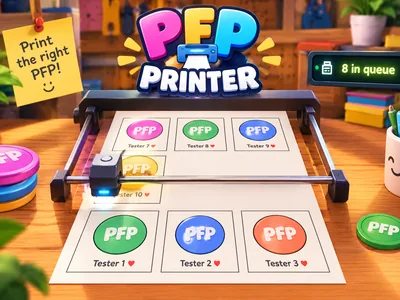
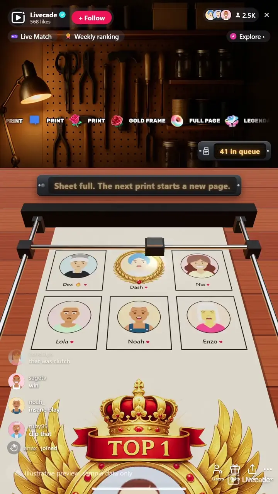

# PFP Printer - Interactive TikTok Live Game

> A printer on your stream prints your viewers' profile pictures, live.

A 3D printer on your stream prints your viewers' profile pictures live, six to a sheet. A follow or a comment gets a viewer a photo, and gifts skip the line for gold frames and full-page prints.

**[Play PFP Printer on Livecade](https://livecade.io/games/pfp-printer/?utm_source=github&utm_medium=readme&utm_campaign=pfp-printer)** - runs as a single browser source in OBS, Streamlabs, or TikTok LIVE Studio. Nothing for viewers to install.

## How viewers play

Viewers take part with the actions TikTok already gives them: **comments**, **follows**, **gifts**, **likes**, **shares**. Every action below is rebindable, so you decide which interaction drives which effect.

| Action | What it does |
| --- | --- |
| **Print photo** | Prints the viewer's profile picture as a photo on the sheet. From a gift it skips the line |
| **Gold frame** | A photo in a gold laurel frame, ahead of the free queue |
| **Full page** | A full page in a wreath of peonies and red lanterns, on a sheet of its own |
| **Legendary page** | A full page in a winged gold crest with a crown and a TOP 1 ribbon |

## How it works

### Follow or comment, get printed

A follow or any comment puts a viewer in the print queue, and the printer prints their profile picture on the sheet with their name under it.

### Gifts skip the line

A gift prints ahead of the free queue, and ten Roses in a streak are ten photos. The bigger gifts buy a gold frame or a full page of their own.

### Six to a sheet

Six photos fill a sheet, then the roll feeds it down the screen and a blank one comes up. A viewer is never printed for free twice on one sheet.

### Speeds up when busy

About two and a half seconds a photo at normal speed, faster on its own when the line is long. Slow, normal and fast are a setting.

## About the game

PFP Printer puts a chrome gantry printer on a wooden table across the bottom of your stream and feeds it your audience. A viewer follows or comments and joins the print queue. When their turn comes, the head sweeps back and forth across the paper and their profile picture appears line by line behind it: a round photo in a thin border, with their name and a small heart under it. Six photos fill a sheet. Then the roll feeds the sheet down the screen, a blank one comes up under the head, and the sheet before it stays in view below.

### Gifts skip the line

A gift goes ahead of everyone waiting for a free print. Out of the box a Rose prints a photo, a Rosa a photo in a gold laurel frame, a Doughnut a full page in a wreath of peonies and red lanterns, and a Hand Heart a full page in a winged gold crest with a crown and a TOP 1 ribbon. Every gift with a trigger prints, streaks included, so ten Roses are ten photos. A full page needs a sheet of its own, so the sheet on the bed feeds out first and the free prints carry on on a new one after it.

### Every gift prints something

A gift with no trigger of its own still prints by its value: 1 coin a photo, 10 coins a gold frame, every 30 coins a full page and every 100 a legendary page. Turn that setting off and only the gifts you bound print.

### Keeps up with a busy chat

A photo takes about two and a half seconds at normal speed. With eight or more prints waiting the printer speeds up on its own, and again at twenty, so a big stream keeps moving. A counter shows how many are in the queue. A viewer can come back for another free print later, but never twice on the same sheet, so one regular cannot fill the page.

## What it looks like on stream

[Watch PFP Printer gameplay](https://cdn.livecade.io/games/pfp-printer.mp4)

## What you can configure

- **Language** - Thirteen languages for the print ticker, the queue counter and the trigger labels
- **Print speed** - Slow, normal or fast. The printer also speeds up by itself when many viewers are waiting
- **Other gifts print by their value** - A gift with no trigger of its own still prints: 1 coin a photo, 10 a gold frame, every 30 a full page, every 100 a legendary page
- **Scene** - Six rooms above the printer, from a workshop to a print shop, or a custom scene with a solid color, a transparent background for your camera, or your own image

## Languages

English, Spanish, Portuguese, French, German, Italian, Indonesian, Arabic, Turkish, Russian, Hindi, Romanian, Filipino

## FAQ

<strong>How do viewers get their picture printed in PFP Printer?</strong>

Out of the box a follow or any comment puts them in the print queue. Every trigger can be rebound, so likes, shares or any gift can be the way in instead.

<strong>Can a viewer be printed more than once?</strong>

Yes. A viewer has one free print waiting at a time and is never printed for free twice on the same sheet, so they can come back on a later sheet. Gifts print every time, on any sheet.

<strong>What do gifts do?</strong>

A gift prints ahead of everyone waiting for a free print. By default a Rose is a photo, a Rosa a gold frame, a Doughnut a full page and a Hand Heart a legendary TOP 1 page. Every gift with a trigger prints, streaks included, and a gift with no trigger of its own prints once by the coin value of the whole send.

<strong>Does the printer keep up with a big stream?</strong>

It prints a photo about every two and a half seconds at normal speed and speeds up on its own when eight or more prints are waiting. On a very busy stream the free line fills up to its limit of 200 waiting, while gifts always go to the front.

<strong>Will PFP Printer run on my PC?</strong>

It renders in 3D on the computer running your stream, so give it a reasonably modern machine. Try it in the dashboard preview before you go live.

<strong>How do I add PFP Printer to my TikTok Live?</strong>

Add one browser source URL to OBS or your streaming software and go live. There is no plugin to install and nothing for your viewers to download.

## Setup

1. [Create a Livecade account](https://app.livecade.io/register?utm_source=github&utm_medium=cta&utm_campaign=pfp-printer)
2. Copy your overlay browser source URL
3. Paste it into OBS, Streamlabs, or TikTok LIVE Studio
4. Pick PFP Printer, set your triggers, and go live

Runs in the browser, so it works on Windows and macOS with nothing to download. [See all TikTok Live games](https://livecade.io/tiktok-live-games/?utm_source=github&utm_medium=readme&utm_campaign=pfp-printer).

---

_This repository documents PFP Printer, a hosted interactive game by [Livecade](https://livecade.io/?utm_source=github&utm_medium=footer&utm_campaign=pfp-printer). The game runs on Livecade's platform, so there is no source to install here._
